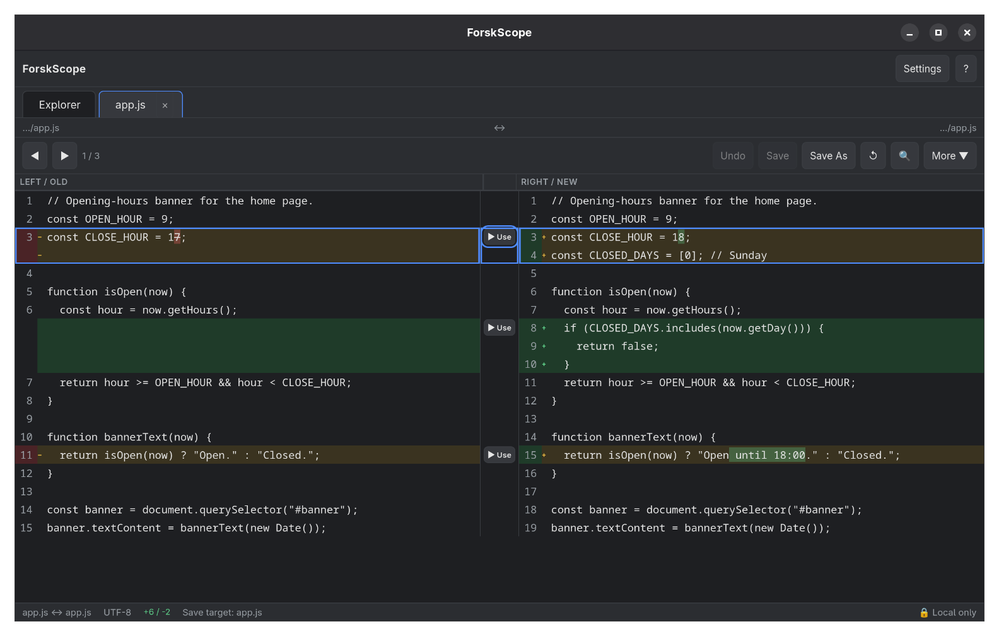
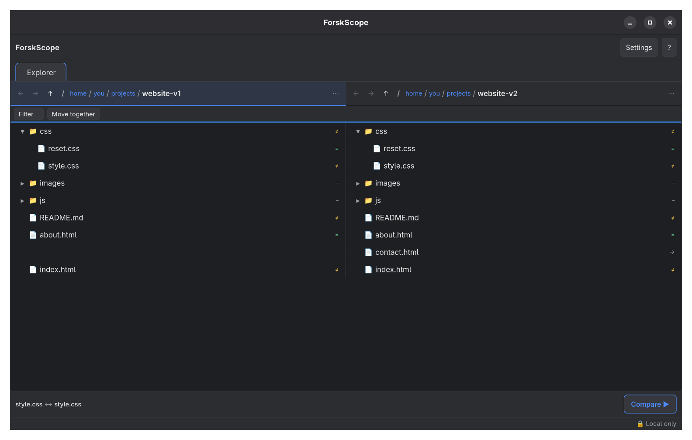

# ForskScope

[](LICENSE)
[](https://github.com/forskscope/forskscope/actions/workflows/ci.yml)
[](https://github.com/forskscope/forskscope/actions/workflows/release.yml)


Diff and merge through Exploring 🕵️‍♀️ GUI tool, local-first, with cross-platform support 💻️ named after "*forske forskjell*" (research difference) 🤍

```
forskscope old/src/main.rs new/src/main.rs
```

ForskScope opens two files side by side, highlights every changed line, and lets you apply changes from left to right one at a time with a single keystroke. It also compares two folders through the Explorer. Everything runs locally: no accounts, no uploads, no telemetry. The one exception is *Check for updates* in the About dialog, which sends a single request to GitHub for the latest version number, and only when you click it.



Move between changes with F7 / F8 and apply one with Enter or its **Use** button. Turn on **More ▼ → Inline diff** to see which characters changed within a line, as shown here.



Browse two folders side by side. Each file shows whether it is identical (=), different (≠) or on one side only (→). Pick one on each side and press **Compare**.

---

## Why ForskScope

ForskScope began as one more option among the GUI tools for comparing and merging files on Linux, where its author found the choices too few.

- **Your files stay on your computer.** No accounts, no uploads, no telemetry. The only network request is the one you make by clicking *Check for updates*.
- **Start from folders, not only files.** The Explorer shows two directory trees side by side, marks each file as identical, different or on one side only, and opens any pair you pick.
- **It does not claim more than it checked.** A file is marked identical only after its contents were compared. When only the sizes match, it says so, and **Verify** reads every byte to find out.
- **Spreadsheets too.** `.xlsx` workbooks are compared sheet by sheet and cell by cell, read-only, with rows lined up by content where that shows fewer changes.
- **Keyboard first.** Move between changes, apply them, search, and switch panes without the mouse.
- **One app on Linux, macOS and Windows**, written in Rust with [Dioxus](https://dioxuslabs.com/) and the [similar](https://docs.rs/similar) diff engine.

---

## Install

Prebuilt binaries for Linux, macOS, and Windows are on the
[Releases page](https://github.com/forskscope/forskscope/releases). Windows is
also on the [Microsoft Store](https://apps.microsoft.com/detail/9p63f7npc3mh)
(not always the newest build).

```sh
# Linux — prebuilt (Ubuntu-built; see note below)
# Resolves the newest release automatically -- no version to keep in step.
url=$(curl -s https://api.github.com/repos/forskscope/forskscope/releases/latest \
  | grep -o 'https://[^"]*-linux-x86_64\.tar\.gz')
curl -LO "$url"
tar -xzf forskscope-v*-linux-x86_64.tar.gz
./forskscope

# Any distribution — build from source (Rust 1.91+)
sudo apt-get install libwebkit2gtk-4.1-dev libgtk-3-dev pkg-config libssl-dev
cargo build --release -p forskscope-ui && ./target/release/forskscope
```

> The prebuilt Linux binary is built on Ubuntu, so it needs a glibc at least
> as new as that build runner's. It starts on Arch as well — see
> [Installation](docs/src/users/installation.md) for the detail, and for macOS
> Gatekeeper and Windows WebView2 notes.

**[Full installation guide →](docs/src/users/installation.md)**

### Compare two files

```sh
forskscope old.rs new.rs
```

### Use with Git

```sh
# .gitconfig
[diff]
  tool = forskscope
[difftool "forskscope"]
  cmd = forskscope "$LOCAL" "$REMOTE"
[merge]
  tool = forskscope
[mergetool "forskscope"]
  cmd = forskscope "$LOCAL" "$REMOTE" "$MERGED"

# Then:
git difftool HEAD -- src/main.rs
git mergetool
```

---

## Features

- **Side-by-side diff** with line-level highlighting, and character-level highlighting when you turn on *Inline diff*
- **Merge** — apply changes from left to right one hunk at a time; undo / redo
- **Enter to apply** the focused hunk; F7/F8 to navigate; Ctrl+S to save
- **Explorer** — browse two directories, see digest equality indicators, compare same-name files with one click
- **Deep compare** — recursive directory scan with live progress; batch copy changed files between trees
- **Deep compare filter** — Different / All / Equal only in the deep compare report
- **Git difftool / mergetool** compatible: `forskscope old new`, or `forskscope local remote merged` to save the result to the merged file. Merging with a common ancestor (three-way) is not available in the app
- **Compare profiles** — named presets for ignore-whitespace, ignore-case, and algorithm (Myers / Patience / Histogram)
- **Session persistence** — open tabs are restored on next launch
- **Patch export** — export a unified-diff `.patch` file from a file comparison; compatible with `patch -p1` and `git apply`
- **Safe saves** — atomic write (never a partial file; not a power-loss guarantee — see [Merging](docs/src/users/merging.md)), `.bak` backup, external-change detection
- **Search within diff** — Ctrl+F highlights matching rows across both panes
- **Navigation history** — back/forward per explorer pane
- **Dark, Light, and Night themes**
- **English and Japanese UI** (i18n)
- **Spreadsheets** — `.xlsx` sheet and cell comparison, read-only
- **Binary files** — off by default; turn on in Settings → Advanced for a hex preview
- **Check for updates** — in the About dialog, only when you click it
- **Verifiable downloads** — every release includes `SHA256SUMS`

---

## Keyboard shortcuts

| Key | Action |
|-----|--------|
| F7 / F8 | Previous / next change |
| Enter | Apply focused change |
| Ctrl+Z | Undo |
| Ctrl+S | Save |
| Ctrl+F | Search within diff |
| F3 / Shift+F3 | Next / previous search match |
| Ctrl+/ | Keyboard shortcut reference |

Press **?** in the header or **Ctrl+/** for the full reference.

---

## Documentation

Full documentation (built with mdbook): [`docs/src/`](docs/src/SUMMARY.md)

---

## License

Apache-2.0 — see [LICENSE](LICENSE). Author: **nabbisen**.
