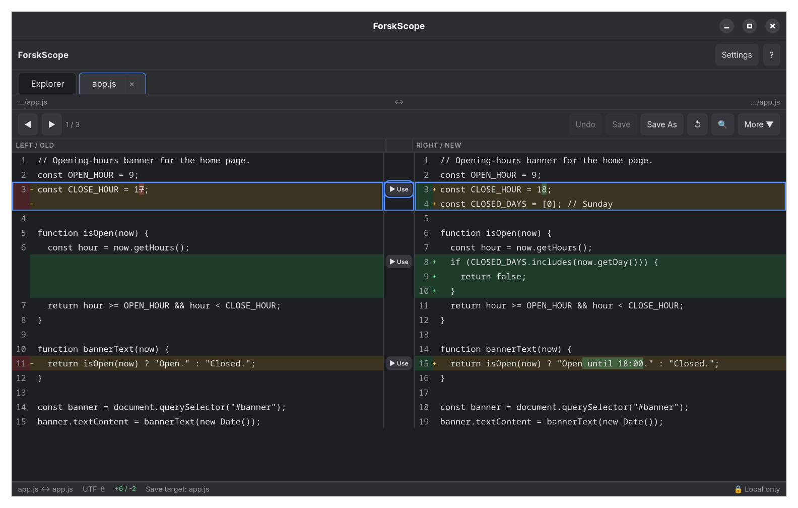
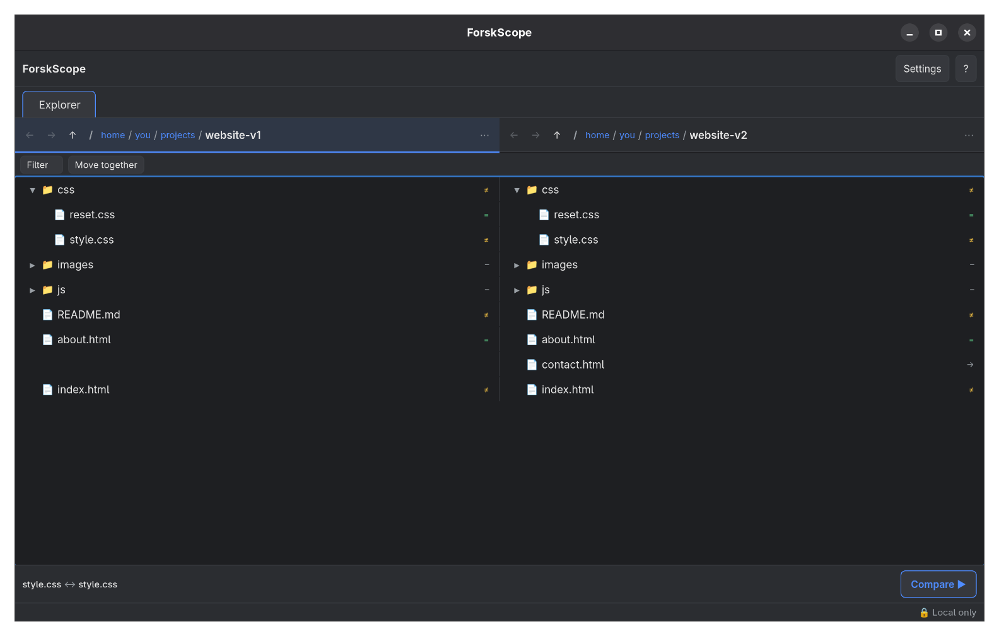

# ForskScope

[](LICENSE)
[](https://github.com/forskscope/forskscope/actions/workflows/ci.yml)
[](https://github.com/forskscope/forskscope/actions/workflows/release.yml)

Website and user guide: https://forskscope.github.io/forskscope/


Diff and merge through Exploring 🕵️‍♀️ GUI tool, local-first, with cross-platform support 💻️ named after "*forske forskjell*" (research difference) 🤍

```
forskscope old/src/main.rs new/src/main.rs
```

ForskScope opens two files side by side, highlights every changed line, and lets you apply changes from left to right one at a time with a single keystroke. It also compares two folders through the Explorer. Everything runs locally: no accounts, no uploads, no telemetry. The one exception is *Check for updates* in the About dialog, which sends a single request to GitHub for the latest version number, and only when you click it.



Move between changes with F7 / F8 and apply one with Enter or its **Use** button. Turn on **More ▼ → Inline diff** to see which characters changed within a line, as shown here.



Browse two folders side by side. Each file shows whether it is identical (=), different (≠) or on one side only (→). Pick one on each side and press **Compare**.

---

## Why ForskScope

ForskScope began as one more option among the GUI tools for comparing and merging files on Linux, where its author found the choices too few.

- **Your files stay on your computer.** No accounts, no uploads, no telemetry. The only network request is the one you make by clicking *Check for updates*.
- **Work with an AI agent, and keep the decisions.** An agent can compare
  files and folders through `forskscope compare` or ForskScope's MCP server,
  but it cannot change a file: those commands are built without the code that
  writes, and a build check enforces it. Its reports and patches are the same
  ones the app exports, and it can open the window on what it found, so you
  review and merge with your own eyes.
- **Start from folders, not only files.** The Explorer shows two directory trees side by side, marks each file as identical, different or on one side only, and opens any pair you pick.
- **It does not claim more than it checked.** A file is marked identical only after its contents were compared. When only the sizes match, it says so, and **Verify** reads every byte to find out.
- **Spreadsheets too.** `.xlsx` workbooks are compared sheet by sheet and cell by cell, read-only, with rows lined up by content where that shows fewer changes.
- **Made to be usable by everyone.** Every change carries a mark (`+`, `−`,
  `≠`) as well as a colour, and a red–green safe palette is one setting away.
  Moving between changes, applying them, searching and switching panes all
  work without the mouse, and buttons, rows and their states are named for
  assistive technology. In English and Japanese.
- **Carry it with you.** On Windows and Linux it is one program file with no
  installer. A `forskscope-data` folder beside it keeps everything of its own
  there, and `--private` keeps nothing after it closes.
- **One app on Linux, macOS and Windows**, written in Rust with [Dioxus](https://dioxuslabs.com/) and the [similar](https://docs.rs/similar) diff engine.

---

## Install

Prebuilt binaries for Linux, macOS, and Windows are on the
[Releases page](https://github.com/forskscope/forskscope/releases). On Arch
Linux, install [`forskscope`](https://aur.archlinux.org/packages/forskscope)
from the AUR. Windows is also on the
[Microsoft Store](https://apps.microsoft.com/detail/9p63f7npc3mh) (not always
the newest build).

```sh
# Linux — prebuilt (Ubuntu-built; see note below)
# Resolves the newest release automatically -- no version to keep in step.
url=$(curl -s https://api.github.com/repos/forskscope/forskscope/releases/latest \
  | grep -o 'https://[^"]*-linux-x86_64\.tar\.gz')
curl -LO "$url"
tar -xzf forskscope-v*-linux-x86_64.tar.gz
./forskscope

# Any distribution — build from source (Rust 1.91+)
sudo apt-get install libwebkit2gtk-4.1-dev libgtk-3-dev pkg-config libssl-dev
cargo build --release -p forskscope && ./target/release/forskscope
```

> The prebuilt Linux binary is built on Ubuntu, so it needs a glibc at least
> as new as that build runner's. It starts on Arch as well — see
> [Installation](docs/src/users/installation.md) for the detail, and for macOS
> Gatekeeper and Windows WebView2 notes.

**[Full installation guide →](docs/src/users/installation.md)**

### Compare two files

```sh
forskscope old.rs new.rs
```

### Use with Git

```sh
# .gitconfig
[diff]
  tool = forskscope
[difftool "forskscope"]
  cmd = forskscope "$LOCAL" "$REMOTE"
[merge]
  tool = forskscope
[mergetool "forskscope"]
  cmd = forskscope "$LOCAL" "$REMOTE" "$MERGED"

# Then:
git difftool HEAD -- src/main.rs
git mergetool
```

### Use with scripts and AI agents

```sh
# For a script: the result as versioned JSON, with diff-style exit codes
forskscope compare old/ new/ --format json

# For an AI agent: an MCP server over standard input and output
forskscope mcp --root ~/my-project --allow-show
```

Both are read-only, open no network connection, and keep nothing between runs.
The MCP server reads only inside the `--root` folders you name. With
`--allow-show`, an agent can open the ForskScope window on the pair it found,
so the person sees exactly what the agent saw. See
[Using ForskScope from scripts and AI agents](docs/src/intermediate/scripts-and-agents.md).

---

## Features

- **Side-by-side diff** with line-level highlighting, and character-level highlighting when you turn on *Inline diff* (or set a profile to show it automatically)
- **Merge** — apply changes from left to right one hunk at a time; undo / redo
- **Enter to apply** the focused hunk; F7/F8 to navigate; Ctrl+S to save
- **Explorer** — browse two directories, see digest equality indicators, double-click a same-name file to compare it instantly
- **Deep compare** — recursive directory scan with live progress; batch copy changed files between trees
- **Deep compare filter** — Different / All / Equal only in the deep compare report
- **Git difftool / mergetool** compatible: `forskscope old new`, or `forskscope local remote merged` to save the result to the merged file. Merging with a common ancestor (three-way) is not available in the app
- **Compare profiles** — named presets for ignore-whitespace, ignore-case,
  ignore-line-ending (CRLF/LF), algorithm (Myers / Patience / Histogram), and
  inline-diff highlighting mode (lazy / eager / never)
- **Session persistence** — open file comparison tabs, and which one was active, are restored on next launch; folder comparisons are not
- **Reports and patches** — save a file or folder comparison as a self-contained HTML report (with the SHA-256 of every file) or a unified-diff patch, compatible with `patch -p1` and `git apply`
- **Scripts and AI agents** — `forskscope compare` (text, JSON, patch, HTML) and `forskscope mcp`, read-only, with no network
- **Safe saves** — atomic write (never a partial file; not a power-loss guarantee — see [Merging](docs/src/users/merging.md)), `.bak` backup, external-change detection
- **Search within diff** — Ctrl+F highlights matching rows across both panes
- **Navigation history** — back/forward per explorer pane
- **Dark, Light, and Night themes**, and a red–green safe colour palette; every change is marked by a sign as well as a colour
- **English and Japanese UI** (i18n)
- **Spreadsheets** — `.xlsx` sheet and cell comparison, read-only
- **Binary files** — off by default; turn on in Settings → Advanced for a hex preview
- **Portable and private modes** — a `forskscope-data` folder beside the program, or `--private` to keep nothing
- **Check for updates** — in the About dialog, only when you click it
- **Verifiable downloads** — every release includes `SHA256SUMS`

---

## Keyboard shortcuts

| Key | Action |
|-----|--------|
| F7 / F8 | Previous / next change |
| Enter | Apply focused change |
| Ctrl+Z | Undo |
| Ctrl+S | Save |
| Ctrl+F | Search within diff |
| F3 / Shift+F3 | Next / previous search match |
| Ctrl+/ | Keyboard shortcut reference |

Press the **?** button in the tab bar for the full reference — it always
works. **Ctrl+/** does the same thing, but only while a file or directory
comparison tab is open; it's ignored on the Explorer tab.

---

## Documentation

Full documentation (built with mdbook): [`docs/src/`](docs/src/SUMMARY.md)

---

## License

Apache-2.0 — see [LICENSE](LICENSE). Author: [**nabbisen**](https://github.com/nabbisen).
